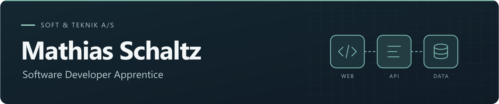

I'm a **software developer apprentice at Soft & Teknik A/S**, training as a data technician with a specialization in programming. I build and maintain internal web applications, with most of my hands-on work in **C#, ASP.NET Core, SQL and Microsoft integrations**.

## Skills

### Languages

### Frameworks & libraries

ASP.NET Core MVC · REST APIs · Entity Framework Core · Booking and availability logic

### Data & cloud

SQL Server · Azure SQL · Microsoft Entra ID · Microsoft Graph

### Tools & hosting

Azure DevOps · Docker Compose · AVEVA System Platform · QuickScript

**Contact** · [mah@sogt.dk](mailto:mah@sogt.dk)
